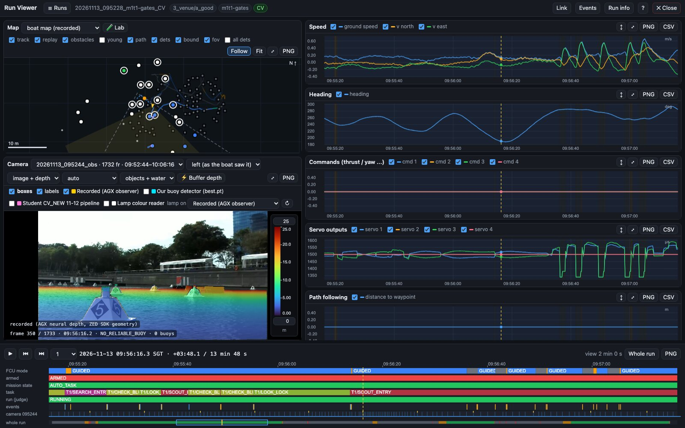
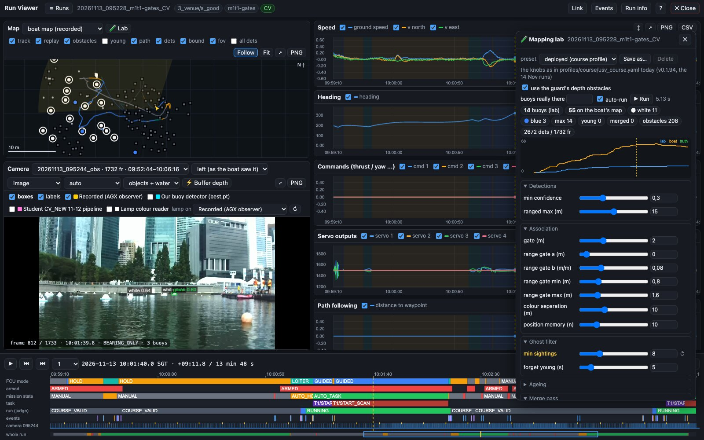
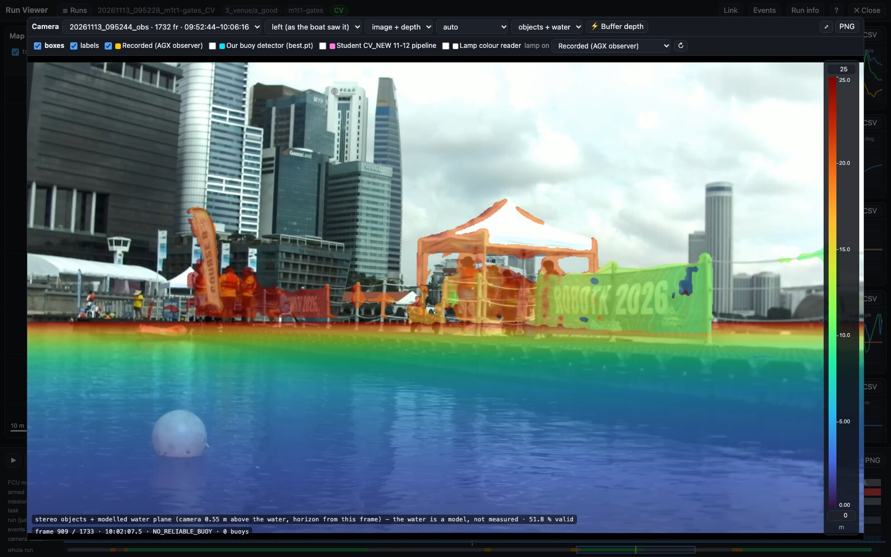

# usv-logview — a run viewer for RobotX USV logs

Study one run of an autonomous surface vessel in the browser: the boat's track and its own map replayed, the ZED stereo camera
(decoded straight from `.svo2`, no ZED SDK needed) with depth and detection boxes, zoomable telemetry charts, and a timebar with the
autopilot mode, the mission state and the judges' run state - all on one clock. Plus a **mapping lab** that re-runs the boat's own mapping
code on the logged detections with tweakable knobs.

Built for **OptiPrime's USV at RobotX 2026** (Marina Bay, Singapore, November 2026). The boat's software lives in the team repository
[OPTIPRIME-SIT/USV-master-scripts](https://github.com/OPTIPRIME-SIT/USV-master-scripts) (private, team access); the mapping lab and the
lamp reader import from it, everything else runs on its own.


*The 13 Nov morning Task 1 attempt: the boat's own map (buoys, depth obstacles) and track, the camera with the ZED's neural depth and the
boat's recorded detections, telemetry, and the timebar (FCU mode, armed, mission state, task, judge run state, events, camera coverage).*


*The mapping lab: the same run re-mapped with the ghost filter at 8 sightings - 14 buoys instead of the 55 on the boat's map.*


*The camera expanded: stereo depth computed on the Mac (objects from stereo, the water from a fitted plane) with its metre scale.*

## Run it

```bash
git clone https://github.com/ExtraDmitr/usv-logview.git
cd usv-logview
LOGVIEW_DATA=/path/to/DATASETS ./run.sh          # first start builds .venv (a few minutes); opens http://127.0.0.1:8770/
```

Needs Python 3.10+ and `ffmpeg` (`brew install ffmpeg` / `apt install ffmpeg`; on a Mac the video cache uses the hardware encoder, elsewhere
libx264). Options: `--port N`, `--no-browser`. Stop it with **✕ Close** in the page or Ctrl-C. `.venv/bin/python selftest.py` checks
every run loads and the engines are available.

Paths in `engines.json` use `${DATASETS}`, `${ROBOTX}` (the folder holding DATASETS and MASTER_SCRIPTS) and `${MASTER_SCRIPTS}` (the
team repo checkout); set them as environment variables if your layout differs (defaults: `LOGVIEW_DATA` = two folders up from the tool,
`ROBOTX` = its parent, `MASTER_SCRIPTS` = `$ROBOTX/MASTER_SCRIPTS`). Model weights are not in this repository.

## The data it reads

A `DATASETS` folder with `index.csv` (one row per run: category, run, date, start, mission, cv, motion, frames, ...) and one folder per run:

```
<category>/<YYYYMMDD_HHMMSS>_<mission>[_CV]/
  run.json                      where every piece came from, boat and camera statistics
  camera/<session>/             cam.svo2 (ZED 2i), frames.jsonl (per frame: time, svo_frame, pose, detections), session.json, pairs/
  motion/run_*/                 *_run.csv (10 Hz telemetry), *_run.events, *_run.tlog (MAVLink), mm_trace.jsonl, boat_*.sqlite, maps/*_map.jsonl
  operator/run_*/               ocs.log, hub_*.sqlite; operator/maps/
  perception_logs/  mac_frames/
```

Boat-console sessions (`<stem>.csv` + `.events` + `.tlog`) anywhere in DATASETS are listed too. The viewer writes only
`camera/*/.logview_cache/` (video caches, rebuilt on demand). The logs themselves are not in this repository.

## Details

Study one run of `RobotX/DATASETS` in the browser: map, camera (+ depth, CV boxes), charts and a timebar on one clock.

```
cd RobotX/DATASETS/_tools/logview
./run.sh                 # opens http://127.0.0.1:8770/ ; first start builds .venv (a few minutes)
./run.sh --port 8771 --no-browser
.venv/bin/python selftest.py   # loads every run, checks the engines (≈ 10 s)
```
Needs `ffmpeg` (Homebrew) for the video cache. Works offline (no internet, no CDN).

## What is on the page

| tile | what | interaction |
|---|---|---|
| **Runs** (☰) | all 93 runs (`index.csv`) + 43 boat-console sessions (pool 3, console logs) | search, filter by category / kind / CV, sort by column, click to open |
| **Map** | the track (coloured by FCU mode, the future faint), the boat + camera field of view, the boat's own map **replayed at the current time** (buoys by colour, obstacles grey, faint = not yet confirmed, a ring = lamp), the planned path + carrot, gates, the course boundary, camera detections placed from each frame's pose | wheel zoom, drag pan, Follow / Fit, hover = tooltip, click = details pop-up, layer ticks |
| **Camera** | the left (or right) image of the ZED recording at the current time; **depth** (image / depth / image + depth) with a **colour scale in metres** (edit near / far; hover = a pixel's depth); **boxes** from the ticked CV engines | hover a box = tooltip, click = all its fields; ⤢ expand; PNG = the frame with boxes (+ depth and scale) |
| **Charts** | speed, heading, commands, servo outputs, path following, GNSS, buoys in view; FCU mode tinted behind; the dashed line = now | wheel zoom (time), drag = scrub, Shift / right-drag = pan, double-click = whole run, legend ticks, ↕ taller, ⤢ expand, PNG, CSV (the visible window) |
| **Timebar** | lanes: FCU mode, armed, mission state, task, run (judge: COURSE_VALID → DECLARED → READY → RUNNING); event ticks; camera coverage (yellow ticks = frames with recorded AGX depth); the whole run with the view box | as the charts; hover a lane = its span, double-click = details; click an event tick = the events there; drag the blue box to pan |
| header | **✕ Close** = stop the server process (asks first) · **Link** = copy a link to this exact moment (run, time, view, engines), **Events** = the run's events as a list (click = jump), **Run info** = run.json, **?** = shortcuts |

Keys: <kbd>Space</kbd> play / pause · <kbd>←</kbd> <kbd>→</kbd> one camera frame (Shift 1 s, Alt 10 s) · <kbd>+</kbd> <kbd>-</kbd> speed · <kbd>Esc</kbd> close.

## How the camera works

- `.svo2` is MCAP (written by the ZED SDK); the `side_by_side` channel holds both eyes per frame, H.265 (12-14 Nov) or H.264 (11 Nov), with
  an 8-byte header. Two layouts: hd2k recordings stack left over right (2208 x 2484), FHD ones put them side by side (3840 x 1080); both
  are detected. No ZED SDK is needed on the Mac.
- The .svo2 stores the **raw lens images**; the boat's detector, its boxes and its depth all used the SDK's **rectified** left image. So the
  viewer shows the left eye in that geometry: undistorted with the factory calibration (`calib/SN33545355.conf`) and a small similarity
  (≈ 8 px, 14 px, 0.06°, 0.4 % at 2208 wide) **registered per session on the SDK images the observer saved** (`pairs/rgb_*.jpg`); the
  result matches those images to 0–1 px (median). Recorded boxes, recorded depth and the CV engines all work in this geometry.
- Eyes (camera header): **left (as the boat saw it)** · **left raw lens** · **right raw lens**. Boxes and depth are drawn on the first only.
- Cache (first open of a recording, ≈ 15–35 s): `camera/<session>/.logview_cache/` = `left_raw.mp4`, `left.mp4` (rectified),
  `right_raw.mp4` (on first stereo / right-eye use), `index.json` (frame times, size, codec, layout, geometry, version). An old-version cache
  is rebuilt automatically.
- The recordings hold the observer's frames (≈ 2 fps on most runs, irregular), so the viewer's clock is the master and the video is
  stepped to the frame recorded at or before the current time.
- **Depth** (all in the rectified-left geometry): `recorded` = the AGX's NEURAL depth saved for some frames (`pairs/depth_*.png`, mm;
  yellow ticks on the timebar), exact; `stereo` = computed on the Mac for any frame from the raw pair (OpenCV SGBM, half resolution,
  left-right check, low-texture water / sky masked out, median filter), then mapped into the rectified-left geometry by one homography.
  It agrees with the neural depth to a median 4–5 % where both exist. Water is the hard part: ripples and **reflections** (a mirrored
  building measures as far away, below the water) give patchy, partly wrong stereo depth. Stereo modes (camera header):
  **objects + water** (default) = stereo only for points standing > 0.15 m above the water plane (buoys, boats, shore), the water drawn from
  the plane (a MODEL: camera height fitted per session from the recorded neural depth, ≈ 0.55 m; horizon found per frame from the water
  pixels); **objects only** = the same without the modelled water; **raw SGBM** = everything, for comparison.
  `auto` = recorded where saved, else stereo. A depth map is only ever drawn on its own frame: while the next one is computed the layer is
  hidden ("computing depth…").
- **⚡ Buffer depth**: precomputes depth into a sliding buffer on the server (30 frames behind to 240 ahead of the cursor, at 560 px wide;
  ≈ 30 frames/s, reading the cached streams sequentially) that follows playback; playing with depth then shows depth on every frame and
  waits ("buffering depth…") rather than showing a stale one. Dropped when another log, session, source or mode is chosen, or on a second
  click. Without it, playback shows depth only on the frames with recorded AGX depth.

## Map sources and the mapping lab

The map menu: **boat map (recorded)** = the boat's own map as it was (`motion/*/maps/*_map.jsonl`), **operator map (recorded)** = the
shore's copy, **lab replay**, **no map**. Layers: obstacles (the guard's depth clusters, grey squares), young (lab only: buoys still below
the ghost filter, dashed).

**🧪 Lab**: re-runs the boat's own mapping code (`MASTER_SCRIPTS/optiprimex/usv/perception_map.py`, fed through `cv/publish/cv_publish.py`
exactly as on the boat) on the run's logged camera detections, with the course profile's knobs overridden — detections (min confidence,
ranged max), association (gate, range gate, colour separation, position memory), ghost filter (min sightings, forget), ageing, merge pass,
rays / triangulation, colour votes, lamps, depth fusion; optionally the guard's depth obstacles from the boat's sqlite. Changes re-run it in
≈ 0.1–2 s; the map shows the result at every second of the run. The lab shows the end counts by colour, the boat's recorded count, your
"really there" count, and a buoys-over-time chart (lab / boat / truth).
Presets: built-in **deployed (course profile)** (today's v0.1.94 knobs) and **as on 13 Nov (v0.1.93)** (no far-depth limit, merge, lamp
tracker or depth fusion); **Save as…** writes `presets/mapping/<name>.json`. The replay is close to, not identical with, the boat's map
(the boat's live timing; the guard's extra logic gives more depth obstacles in the replay). It never changes MASTER_SCRIPTS.
The over-count is real: on 13 Nov morning the boat's own map ended with 63 buoys (and 141 depth obstacles) for about a dozen buoys on the course.

## Layout

Drag the gutters to resize: between the map / camera column and the charts, between the map and the camera, above the timebar, and under
each chart. Double-click a gutter to reset it. Sizes are remembered by the browser.

## CV engines (plug-ins)

`engines/<name>.py` defines `ENGINE = <Engine subclass>()`; paths and options are in `engines.json`. Shipped:

| engine | what |
|---|---|
| `recorded` | the boxes the AGX observer logged during the run (colour, confidence, range, bearing, lamp) — instant, also while playing |
| `yolo_buoys` | our buoy detector, `best.pt` (the weights of the AGX TensorRT engine, md5 320e6a96…), ultralytics on the Mac GPU, imgsz 768, conf 0.6 |
| `cvnew` | the student's CV_NEW 11-12 pipeline (detector 1280 → marker classifier + digit detector), read-only weights |
| `lamp` | the 13 Nov learned lamp model on the lamp band above each box of a base engine (choose the base in "lamp on") |

Engines other than `recorded` run when paused (results are kept per frame; ↻ re-runs). To add one: copy `engines/yolo_buoys.py`,
change `name` / `label` / `detect()`, add its block to `engines.json`, restart. A detector returns boxes in full-resolution left-image
pixels: `{"bbox": [x1, y1, x2, y2], "cls", "conf", "colour", "label", "extra": {...}}`; an `attribute` engine gets `ctx["boxes"]`.

## Files

`server.py` (stdlib HTTP server + API, the depth buffer) · `core.py` (run loading, the video cache) · `depth.py` · `mapping.py` (the lab; `presets/mapping/`) · `engines/` · `engines.json` ·
`static/index.html`, `static/app.js` · `calib/` (ZED factory calibration) · `selftest.py` · `run.sh`.
Writes only `camera/*/.logview_cache/` inside the run folders (delete freely; rebuilt on demand).

---

© 2026 Dmitrii (ExtraDmitr). All rights reserved. No license is granted to copy, modify or distribute this code without permission.
